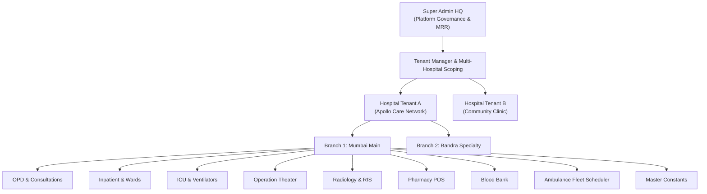

# 🏥 OpenHMS: Modular Hospital Management System & Multi-Tenant Healthcare Network

[](LICENSE)
[](https://php.net)
[](https://laravel.com)
[](https://www.mysql.com)
[-brightgreen.svg)](https://pestphp.com)
[](https://laravel.com/docs/pint)
[](#healthcare-standards--data-localization)
[](#contributing--open-source-community)

**OpenHMS** is an enterprise-grade, open-source Hospital Management System (HMS) and Clinical Health Information Network designed for healthcare providers, multi-specialty hospitals, multi-branch medical chains, clinics, and government health networks.

Engineered with **strict multi-tenant isolation**, a **modular extension engine**, **role-differentiated workspaces**, a **bilingual public patient portal**, **high-density doctor clinical ribbons**, **ICU/ventilator tracking**, **radiology PACS scheduling**, **ambulance fleet dispatch with driver-customer scheduling**, **master clinical constants**, and a secure **"Clear All Data" factory reset** that protects your core software baseline while scrubbing operational records.

---

## 📑 Table of Contents

- [Architectural Highlights](#-architectural-highlights)
- [System Capabilities & Functional Tour](#-system-capabilities--functional-tour)
  - [1. Master Constants & Clinical Taxonomies](#1-master-constants--clinical-taxonomies-new)
  - [2. Fleet (Ambulance) Dispatch & Driver Scheduler](#2-fleet-ambulance-dispatch--driver-scheduler-new)
  - [3. System Settings & "Clear All Data" Factory Reset](#3-system-settings--clear-all-data-factory-reset-new)
  - [4. Operation Theater (OT) Suites & Surgical Meds](#4-operation-theater-ot-suites--surgical-meds)
  - [5. Radiology & Medical Diagnostic Imaging (RIS/PACS)](#5-radiology--medical-diagnostic-imaging-rispacs)
  - [6. ICU & Critical Care Suite with Code Blue Logging](#6-icu--critical-care-suite-with-code-blue-logging)
  - [7. Doctor Calendar, High-Density OPD Ribbon & Rx](#7-doctor-calendar-high-density-opd-ribbon--rx)
  - [8. Pharmacy POS & Stock Management](#8-pharmacy-pos--stock-management)
  - [9. Blood Bank & Immunohematology](#9-blood-bank--immunohematology)
  - [10. Inpatient Wards, Bed Allocation & Dietary](#10-inpatient-wards-bed-allocation--dietary)
  - [11. Billing, GST Invoicing & Insurance TPA](#11-billing-gst-invoicing--insurance-tpa)
  - [12. Vital Records Registry (Births & Deaths)](#12-vital-records-registry-births--deaths)
  - [13. Public Customer Portal & Multilingual Booking](#13-public-customer-portal--multilingual-booking)
- [Security & Penetration Testing Guide](#-security--penetration-testing-guide)
- [Role-Based Default Credentials](#-role-based-default-credentials)
- [Quickstart Installation Guide](#-quickstart-installation-guide)
- [Database Schema & Tenancy Model](#-database-schema--tenancy-model)
- [Contributing & Open Source Community](#-contributing--open-source-community)
- [License](#-license)

---

## 🏛️ Architectural Highlights



- **Strict Multi-Tenant & Branch Scoping**: Built on global `TenantScope` and `BelongsToTenant` traits. Each database query automatically enforces `where hospital_id = ?` without manual developer repetition. Branch administrators are strictly locked to their assigned location (`$user->branch_id`).
- **Dynamic Module Enablement**: Toggle hospital capabilities on the fly (`hospital_modules`). Disabling an extension instantly blocks route access and returns security audit logs.
- **Granular RBAC**: Highly differentiated topbar profiles, navigation layouts, and workspaces for 8 distinct roles: Super Admin, Hospital Director, Branch Head, Doctor, Nurse, Pharmacist, Radiologist, and Accountant.
- **Real-Time Audit Trail**: `AuditLogger` captures user actions, mutations, IP addresses, entity IDs, and security events.

---

## 🚀 System Capabilities & Functional Tour

### 1. Master Constants & Clinical Taxonomies (NEW)
**Route:** `/constants` | **Access:** `super_admin`, `hospital_admin`, `branch_admin`

Clinical governance requires standardized, realistic constants across all hospital branches. OpenHMS provides complete master taxonomy management:

- **Standard Clinical & Administrative Departments**:
  - 18 predefined medical disciplines: Cardiology, Emergency Medicine, General Surgery, Internal Medicine, Pediatrics & Neonatology, OB/GYN, Orthopedics, Neurology, Oncology, Nephrology, Radiology, Pathology, Blood Bank, Pharmacy, Ambulance Fleet, Anesthesiology/ICU, HR, and Billing.
- **Sub-Departments & Specialized Units**:
  - Interventional Cath Lab Suite, Coronary Care Unit (CCU), Acute Red Triage Resuscitation Bay, Level-3 NICU, PICU, 128-Slice Cardiac CT & 3.0T MRI Suites, Major Laminar Flow OTs, Hemodialysis Stations, and Endoscopy Recovery.
- **Staff Professional Designations & Compensation Bands**:
  - Chief Medical Director (CMD), Senior Consultant Physicians, Interventional Cardiologists, Emergency Physicians, RMOs, Nursing Superintendents, ICU Critical Care Nurses, Chief Pharmacists, Emergency Ambulance Paramedics, Ambulance Pilots/Drivers, and Biomedical Engineers with predefined salary bands.
- **Realistic System Constants by Category**:
  - **Emergency Triage Severity Levels (ESI)**: Level 1 Resuscitation (Immediate Red), Level 2 Emergent (<15m Orange), Level 3 Urgent (<30m Yellow), Level 4 Less Urgent (Green), Level 5 Non-Urgent (Blue).
  - **Ambulance Capability Classes**: Advanced Life Support (ALS Cardiac ICU), Basic Life Support (BLS Transit), Neonatal Mobile Transport Unit (NICU on Wheels), Patient Transport Vehicle (PTV).
  - **Hospital Operational Duty Shifts**: Morning General Shift, Evening Ward Shift, 24x7 Night Emergency Shift, Rotational Critical Care Roster.
  - **Billing & Payment Modes**: Cash, Credit/Debit Card, UPI / QR Instant Transfer, Cashless Insurance TPA, Ayushman Bharat PM-JAY.
  - **Inpatient Ward Categories**: General Ward, Semi-Private Deluxe, Single Private AC Room, CCU Cardiac Intensive, NICU Neonatal, Negative-Pressure Isolation.
- **1-Click Pre-population**: Seed all realistic healthcare taxonomies into any new hospital or branch with one click (`POST /constants/seed-defaults`).

---

### 2. Fleet (Ambulance) Dispatch & Driver Scheduler (NEW)
**Route:** `/ambulances` | **Access:** `hospital_admin`, `super_admin`, `branch_admin`, `doctor`, `nurse`

Complete pre-hospital emergency care and patient transport logistics:

- **Fleet Scheduler & Calendar Matrix**:
  - Book and schedule ambulance patient pickups in advance for specific dates and times (`scheduled_for`).
  - **Assign Any Ambulance to Any Driver**: Dynamic assignment matrix decoupling vehicle and driver for specific bookings. Quick-pick from registered fleet drivers or assign certified drivers on demand.
  - **Customer Requirement Capture**: Dedicated customer medical requirement specification (e.g. *“Patient requires continuous BiPAP ventilation, 5L/min O2, wheelchair ramp, and paramedic attendant for inter-hospital transfer”*).
  - Emergency vs Planned Booking: Choose between instant siren dispatch or calendar scheduled transfer.
- **Real-Time Dispatch Lifecycle**:
  - Status progression: `scheduled` &rarr; `dispatched` &rarr; `patient_picked_up` &rarr; `completed` / `cancelled`.
  - Automatic vehicle state synchronization (transitions vehicle to `on_call_dispatch` and returns to `available` at `Hospital Base ER Bay` on handover completion).
  - Dynamic fare calculation, trip distance logging, and triage notes.

---

### 3. System Settings & "Clear All Data" Factory Reset (NEW)
**Route:** `/settings` | **Access:** `super_admin`, `hospital_admin`, `branch_admin`

Comprehensive hospital personalization, patient portal customization, and enterprise data lifecycle management:

- **Hospital Identity & Customer Portal Branding**:
  - Custom hospital name, tagline, accreditation badges (NABH/JCI/NABL), currency, GSTIN, emergency hotlines, and WhatsApp helpline.
  - Interactive hero banner, announcement ribbons, and appointment booking rules.
  - SMS & WhatsApp appointment templates with dynamic tokens (`{patient}`, `{doctor}`, `{token}`, `{time}`).
- **"Clear All Data" Factory Reset**:
  - **The Problem in Hospital Software**: Testing or transitioning from staging to production often leaves dirty mock patients, test invoices, and fake admissions. Wiping the database manually destroys tenant accounts, staff users, and configurations.
  - **The OpenHMS Solution**: A secure "Clear All Data" feature that **deletes all transactional, patient, and billing information while strictly preserving the minimal baseline data required to run the software**.
  - **Data Scrubbed**: Patients, vitals, appointments, consultations, prescriptions, admissions, bed logs, ICU ventilator logs, Code Blue events, OT surgeries, medication logs, radiology orders, blood bank bags, invoices, payments, ambulance trips, attendance, and payroll.
  - **Data Strictly Preserved**:
    - Multi-tenant hospital identities (`hospitals`) and branches (`branches`).
    - Administrative & medical staff login credentials (`users`: Super Admin, Directors, Doctors, Nurses, Pharmacists, Radiologists, Accountants).
    - Hospital module subscriptions (`hospital_modules`).
    - Master Constants, Departments, Sub-Departments, Designations (`hospital_constants`, `departments`, `sub_departments`, `designations`).
    - System settings & frontend configurations (`system_settings`).
    - Facilities master catalog: Wards, Beds (reset to `available`), OT rooms, and Ambulance vehicles (reset to `available`).
  - **Security Protections**:
    - Restricted strictly to `super_admin` and `hospital_admin`.
    - Mandatory administrator password verification (`Hash::check`).
    - Explicit confirmation phrase validation (must type `CLEAR_ALL_DATA`).
    - Full security audit event dispatched (`AuditLogger::log('settings', 'system_factory_reset_cleared', ...)`).

---

### 4. Operation Theater (OT) Suites & Surgical Meds
**Route:** `/ot` | **Access:** `hospital_admin`, `super_admin`, `doctor`, `nurse`

- Major Laminar Airflow Operating Theaters with real-time surgery scheduling.
- PACU (Post-Anesthesia Care Unit) recovery tracking and lead surgeon / scrub nurse team assignments.
- Intraoperative Medication Ledger: Precise dosage, time of administration, route, and narcotic documentation.

---

### 5. Radiology & Medical Diagnostic Imaging (RIS/PACS)
**Route:** `/radiology` | **Access:** `radiologist`, `hospital_admin`, `super_admin`, `doctor`

- Modality Management: 3.0T MRI, 128-Slice CT, Digital X-Ray, Color Doppler Ultrasound, Mammography, DEXA.
- Interactive Schedule View & Walk-In Patient intake.
- Structured DICOM Diagnostic Impression reports with critical findings alerts.

---

### 6. ICU & Critical Care Suite with Code Blue Logging
**Route:** `/icu` | **Access:** `hospital_admin`, `super_admin`, `doctor`, `nurse`

- High-dependency ICU beds with real-time hemodynamic monitoring (GCS, HR, BP, SpO2, Temperature).
- Ventilator Mode Tracking (SIMV, PRVC, CPAP/PSV, PEEP, FiO2, weaning protocols).
- Resuscitation & Code Blue emergency event documentation (CPR duration, biphasic shocks, ROSC outcomes).

---

### 7. Doctor Calendar, High-Density OPD Ribbon & Rx
**Route:** `/doctor-schedule` | **Access:** `doctor`, `hospital_admin`, `super_admin`

- Compact 7-day token strip with real-time patient queue.
- Instant search filter by patient name, MRN, phone, or token.
- High-efficiency digital prescription writer with dosage, frequency, route, and food instructions.

---

### 8. Pharmacy POS & Stock Management
**Route:** `/pharmacy` & `/pharmacy/pos` | **Access:** `pharmacist`, `hospital_admin`, `super_admin`

- High-speed retail and inpatient pharmacy Point of Sale (POS).
- Batch tracking, manufacturing dates, expiry alerts, and rack/shelf locator.
- Automated GST 3004 tax calculation (CGST + SGST) and stock deduction.

---

### 9. Blood Bank & Immunohematology
**Route:** `/blood-bank` | **Access:** `hospital_admin`, `super_admin`, `doctor`, `nurse`

- Voluntary donor registration and screening questionnaire.
- Component separation: Packed Red Blood Cells (PRBC), Fresh Frozen Plasma (FFP), Platelet Concentrate (RDP/SDP), Cryoprecipitate.
- Cross-matching orders and transfusion adverse reaction monitoring.

---

### 10. Inpatient Wards, Bed Allocation & Dietary
**Route:** `/admissions` & `/dietary` | **Access:** `hospital_admin`, `doctor`, `nurse`

- Admission, Discharge, and Transfer (ADT) management.
- Real-time bed occupancy board with color-coded bed status.
- Clinical Dietary Orders: Diabetic, Renal, Low Sodium, Post-Op Liquid, and High Protein inpatient meal tracking.

---

### 11. Billing, GST Invoicing & Insurance TPA
**Route:** `/billing` | **Access:** `accountant`, `hospital_admin`, `super_admin`

- Comprehensive patient hospitalization invoices, OPD slips, and pharmacy receipts.
- Indian Goods & Services Tax (GST) compliant invoicing with HSN/SAC codes.
- Cashless insurance TPA pre-authorization and patient co-pay tracking.

---

### 12. Vital Records Registry (Births & Deaths)
**Route:** `/vital-records` | **Access:** `hospital_admin`, `super_admin`, `doctor`

- Statutory institutional registration of births (APGAR scores, birth weight, delivery mode, mother MRN).
- Statutory death recording (immediate, antecedent, and underlying causes of death, time of death).
- Instant printable Birth and Death verification certificates.

---

### 13. Public Customer Portal & Multilingual Booking
**Route:** `/` | **Access:** Public

- Modern, responsive patient portal with multi-language support (English 🇬🇧, Hindi 🇮🇳, Marathi 🚩, Bengali 🇧🇩).
- Searchable doctor directory with OPD schedules and consultation fee schedules (`₹`).
- Health checkup package catalog with 1-click booking modal.
- Real-time OPD token status tracker.

---

## 🔒 Security & Penetration Testing Guide

OpenHMS includes an automated security penetration test suite ensuring enterprise resilience:

```sh
php artisan test --filter=SecurityPenetrationAndMasterConstantsTest
```

### Verified Security Controls:
1. **Cross-Tenant Data Isolation**: Proves users in Hospital A cannot query, update, or read patient medical records belonging to Hospital B via `TenantScope`.
2. **Branch Scoping & Role Isolation**: Branch administrators are bounded to their specific branch ID.
3. **Privilege Escalation Defense**: Doctors, nurses, and accountants attempting to query `/superadmin/*` routes are intercepted and gracefully redirected with access violations logged.
4. **Module Guard Defense**: If an administrator disables a module (e.g. `blood_bank`), all requests to that module are rejected with `403 Forbidden` and security audit alerts.
5. **Data Reset Authorization Defense**: Unauthorized users attempting `POST /settings/clear-all-data` are rejected. Incorrect passwords or mis-typed confirmation phrases halt execution with zero data wiped.
6. **SQL Injection & Mass Assignment Defense**: Strict `$fillable` arrays on all models and prepared PDO statements across all controllers.

---

## 🔑 Role-Based Default Credentials

All users share the default development password: `password`

| Role | Name | Email | Default Workspace |
| :--- | :--- | :--- | :--- |
| **Super Admin** | Shri Ratan Tata Platform Admin | `superadmin@medisystem.io` | `/superadmin` |
| **Hospital Admin** | Dr. Rajesh Sharma (Director) | `admin@apollocare.in` | `/dashboard` |
| **Branch Admin** | Dr. Vikramaditya Joshi (Bandra Head) | `bandra.head@apollocare.in` | `/dashboard` |
| **Doctor** | Dr. Ananya Sen, MD, DM (Cardiology) | `dr.ananya@apollocare.in` | `/doctor-schedule` |
| **Head Nurse** | Sr. Mary Fernandez (ICU Incharge) | `mary.fernandez@apollocare.in` | `/admissions` |
| **Pharmacist** | Pooja Nair (Chief Pharmacist) | `pooja.pharmacy@apollocare.in` | `/pharmacy` |
| **Radiologist** | Dr. Alok Verma, DMRD | `alok.radiology@apollocare.in` | `/radiology` |
| **Accountant** | Amit Deshmukh (Head Billing) | `finance@apollocare.in` | `/billing` |

---

## 💻 Quickstart Installation Guide

### Prerequisites
- **PHP**: 8.2 or 8.3+ with `pdo`, `mbstring`, `openssl`, `curl`, `gd`, `xml` extensions.
- **Composer**: 2.x
- **Database**: MySQL 8.x, MariaDB 10.x, or SQLite (for local testing).
- **Web Server**: Apache / Nginx / XAMPP / Laravel Herd.

### Step-by-Step Setup

1. **Clone the Repository**:
   ```bash
   git clone https://github.com/mesourish/Modular-Hospital-Management-System.git
   cd Modular-Hospital-Management-System
   ```

2. **Install Composer Dependencies**:
   ```bash
   composer install
   ```

3. **Configure Environment File**:
   ```bash
   cp .env.example .env
   php artisan key:generate
   ```

4. **Configure Database Connection**:
   In your `.env` file, configure your MySQL credentials:
   ```env
   DB_CONNECTION=mysql
   DB_HOST=127.0.0.1
   DB_PORT=3306
   DB_DATABASE=modular_hms
   DB_USERNAME=root
   DB_PASSWORD=
   ```

5. **Run Migrations & Seed Realistic Hospital Data**:
   ```bash
   php artisan migrate:fresh --seed
   ```

6. **Start the Local Development Server**:
   ```bash
   php artisan serve
   ```
   Open your browser and navigate to:
   - **Customer Portal**: `http://localhost:8000`
   - **Staff & Admin Portal**: `http://localhost:8000/login`

---

## 🧪 Testing & Quality Assurance

OpenHMS includes an automated Pest test suite covering multi-tenancy, authentication, clinical workflows, and security penetration:

```bash
# Run all tests
php artisan test

# Run security penetration tests only
php artisan test --filter=SecurityPenetrationAndMasterConstantsTest

# Check code formatting with Laravel Pint
./vendor/bin/pint --test
```

---

## 🤝 Contributing & Open Source Community

We welcome contributions from healthcare professionals, software engineers, and open-source advocates worldwide!

### Branching Model & Branch Protection

To protect clinical safety and prevent untested code from reaching production, this repository enforces a dual-branch structure:

- **`main` (Protected Production)**:
  - Direct pushes to `main` are disabled.
  - Receives code strictly via reviewed Pull Requests from `develop` with all CI checks passing.
- **`develop` (Active Staging)**:
  - The default collaboration branch for all new features and patches.

### How to Configure Branch Protection on GitHub

Repository maintainers should enforce the following in **Settings** &rarr; **Branches** &rarr; **Add branch protection rule**:
1. **Branch name pattern**: `main`
2. **Protect matching branches**:
   - Check **Require a pull request before merging** (at least 1 approval).
   - Check **Dismiss stale pull request approvals when new commits are pushed**.
   - Check **Require status checks to pass before merging** (select GitHub Actions `test-and-lint`).
   - Check **Require conversation resolution before merging**.
   - Check **Do not allow bypassing the above settings** (enforces rules on administrators as well).
3. Set **Default branch** to `develop` under **Settings** &rarr; **General**.

For comprehensive details, see our [Contributing Guide](CONTRIBUTING.md), [Code of Conduct](CODE_OF_CONDUCT.md), and [Security Policy](SECURITY.md).

---

## 📄 License

This software is open-sourced under the **[MIT License](LICENSE)**. You are free to use, modify, distribute, and deploy it for private clinics, public health systems, and commercial hospital networks.

*Engineered with ❤️ for accessible, transparent, and resilient healthcare systems everywhere.*
